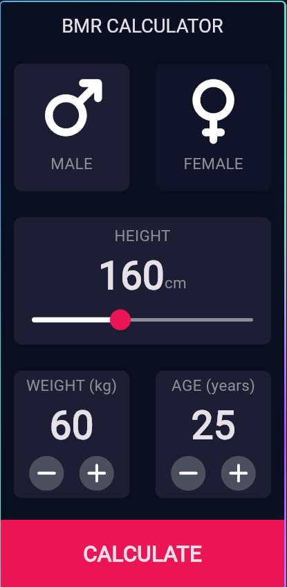
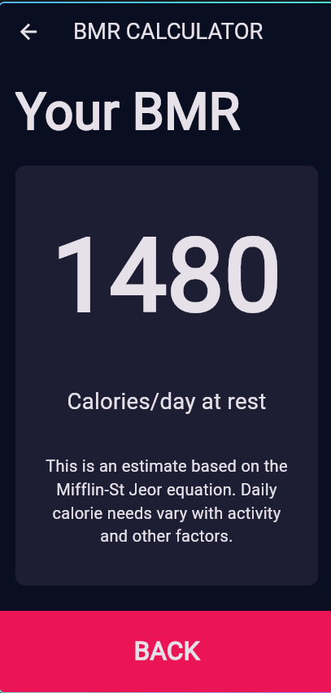

# Kalkulator BMR

## Nama Project

**Kalkulator BMR (Basal Metabolic Rate)** — aplikasi kalkulator BMR berbasis
Flutter.

## Anggota Kelompok

1. **Fais**
2. **Marcel**
3. **Jinan**

## Deskripsi

Aplikasi ini menghitung perkiraan **Basal Metabolic Rate (BMR)**, yaitu jumlah
kalori yang dibutuhkan tubuh saat beristirahat. Pengguna memilih jenis kelamin
dan memasukkan tinggi badan, berat badan, serta usia. Hasil ditampilkan sebagai
perkiraan kalori per hari.

Kalkulasi menggunakan persamaan **Mifflin–St Jeor**:

- Pria: `BMR = 10 × berat (kg) + 6,25 × tinggi (cm) − 5 × usia + 5`
- Wanita: `BMR = 10 × berat (kg) + 6,25 × tinggi (cm) − 5 × usia − 161`

Nilai yang ditampilkan adalah estimasi BMR saat istirahat, bukan kebutuhan
kalori total harian atau saran medis. Kebutuhan kalori harian dapat berbeda
tergantung tingkat aktivitas dan faktor lainnya.

## Screenshot Aplikasi

### Halaman kalkulator



### Halaman hasil



## Cara Menjalankan

Pastikan Flutter SDK telah terpasang, lalu jalankan perintah berikut dari
folder project:

```bash
flutter pub get
flutter run
```

## Referensi

- [BMR Calculator — Calculator.net](https://www.calculator.net/bmr-calculator.html)
